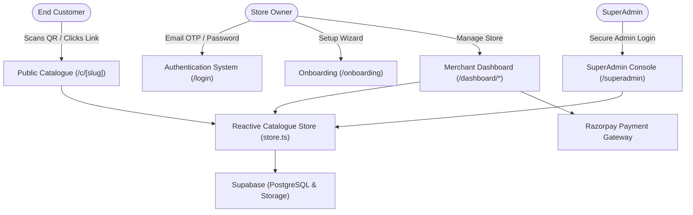
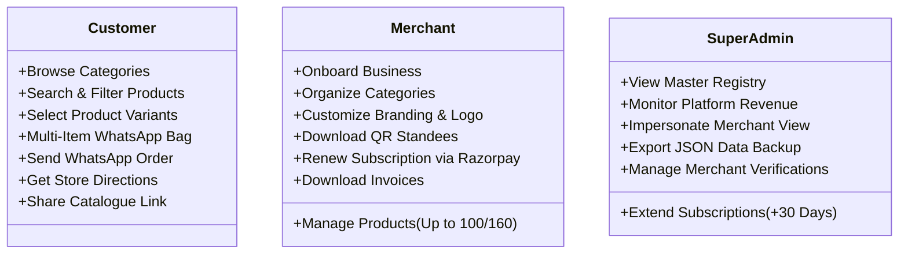
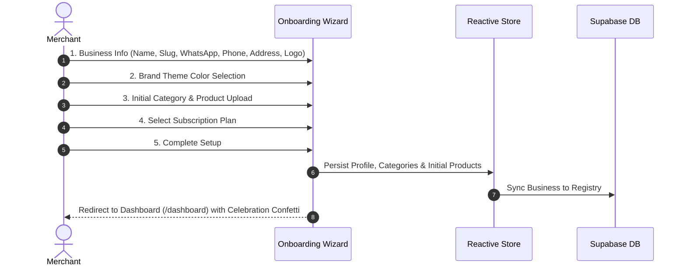
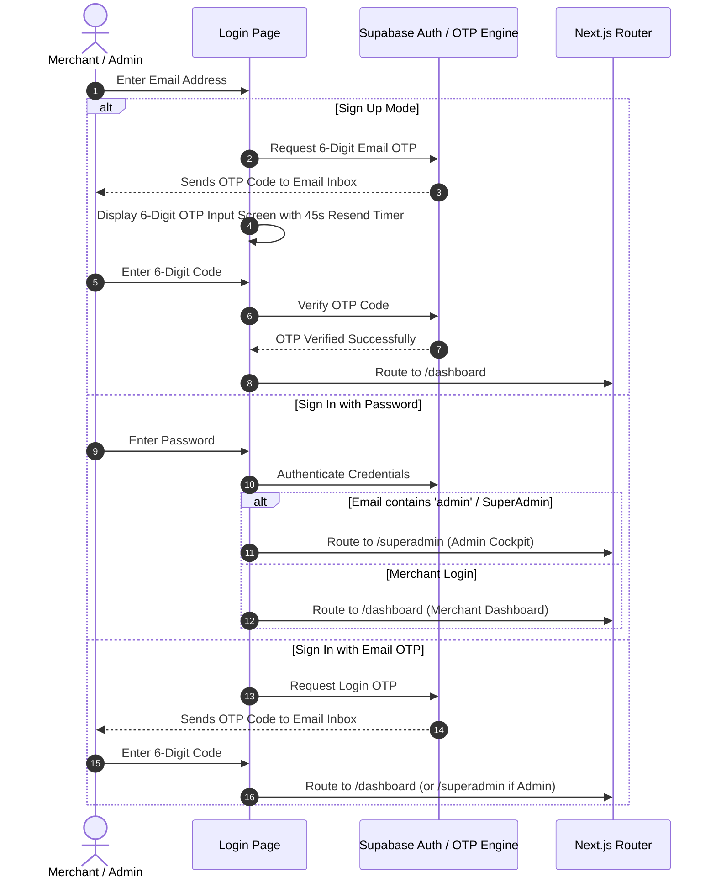
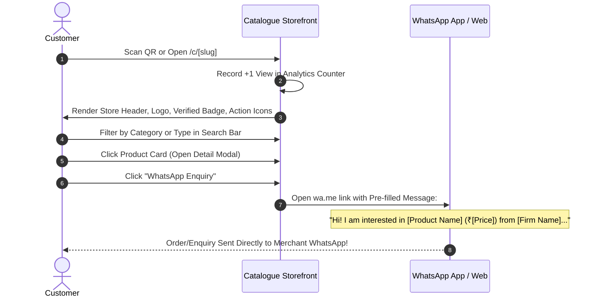
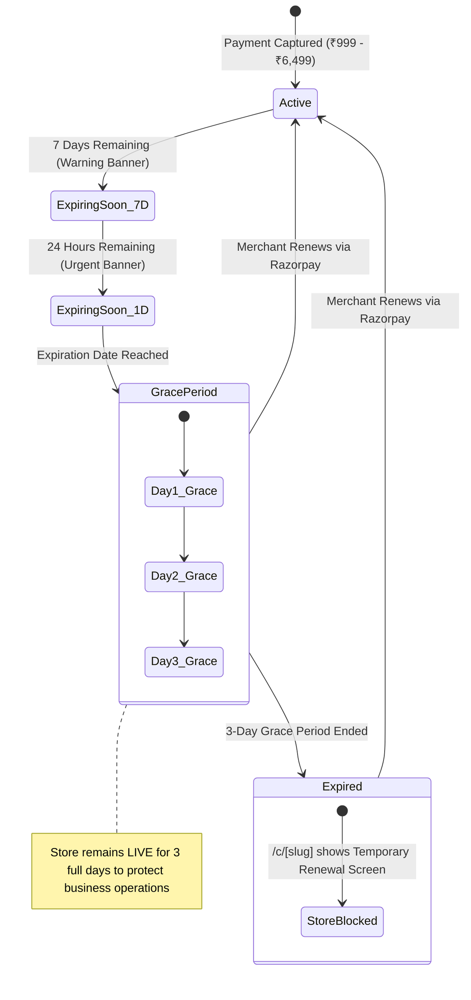
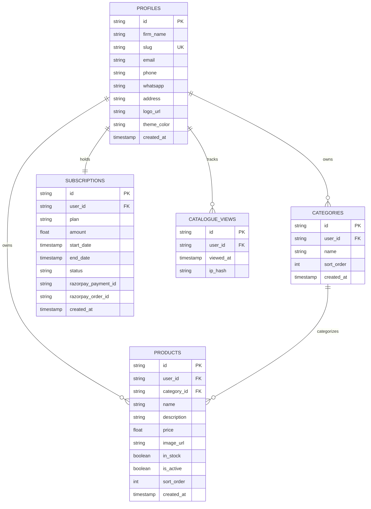
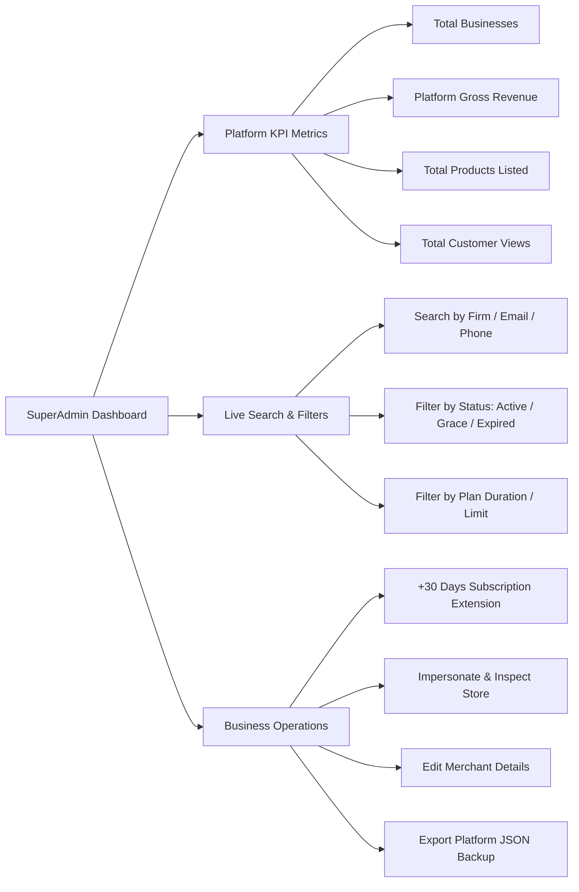

# MyDigiCatalogue — Complete Workflow & System Architecture Documentation

---

## 📌 1. Executive Project Overview

**MyDigiCatalogue** is an enterprise-grade, mobile-first digital product catalogue and WhatsApp commerce platform tailored for Indian manufacturers, wholesalers, retailers, boutiques, and traders.

### Key Value Propositions
- **Replaces Static PDFs & Photos**: Eliminates slow, heavy PDF catalogues and messy WhatsApp photo albums with high-speed, interactive web catalogues.
- **Direct WhatsApp Multi-Item Cart & Enquiry**: Customers browse products, select size/color/weight variants, build a cart order bag, and dispatch structured WhatsApp order sheets.
- **Tabletop QR Standee & Acrylic Tent Card Designer**: Generates print-ready A5/A6/Square tabletop standees with brand themes and QR codes for store counters, cafes, and billing desks.
- **Bulk CSV Product Importer & Exporter**: Batch upload dozens of products in seconds with downloadable sample spreadsheet templates.
- **Product-Level View Analytics**: Tracks individual product views and popular items ranking in the merchant dashboard.
- **Real-Time Sync**: Instant price and product updates without reprinting QR codes or changing links.
- **Automated Lifecycle & Grace Period**: 3-day grace period with timely renewal notices to prevent customer disruptions.
- **Pure Email Authentication**: Secure, frictionless login using **Email OTP** and password authentication.

---

## 🛠 2. Technology Stack & Architecture



| Layer | Technologies Used | Description |
| :--- | :--- | :--- |
| **Frontend Framework** | Next.js 14+ (App Router), React 18, TypeScript | Server and client components, fast SSR routing, and static optimization. |
| **Styling & UI** | Tailwind CSS, Lucide React, Google Fonts (`Outfit` + `Plus Jakarta Sans`) | Custom modern design tokens, glassmorphism, responsive mobile-first layouts. |
| **State & Data Engine** | `CatalogueStore` (`src/lib/store.ts`) | In-memory and `localStorage` reactive data engine with cross-tab event broadcasting (`mydigicat_store_update`). |
| **Database & Auth** | Supabase (PostgreSQL), Supabase Auth (Email OTP) | Scalable relational storage for profiles, products, categories, subscriptions, and views. |
| **Payment Gateway** | Razorpay Checkout SDK (`RazorpayModal.tsx`) | Dynamic, non-editable plan pricing, payment orders, and webhook verification. |
| **Media & QR Engine** | Canvas API, HTML5 Canvas QR Generator | High-resolution PNG and SVG QR standee downloads, client-side image compression (<500KB). |

---

## 👥 3. User Roles & Permission Matrix



---

## 🔄 4. End-to-End User Workflows

### 4.1. Merchant Onboarding & Store Creation (`/onboarding`)



---

### 4.2. Pure Email Authentication Workflow (`/login`)



---

### 4.3. Public Store Customer Journey (`/c/[slug]`)



---

### 4.4. Subscription Lifecycle & Grace Period System



---

## 💳 5. Subscription Plans & Pricing Matrix

| Plan Key | Display Name | Duration | Price (INR) | Product Limit | Description |
| :--- | :--- | :---: | :---: | :---: | :--- |
| `monthly_100` | **Monthly 100** | 30 Days | **₹999** | 100 Products | Essential monthly catalogue for small boutiques and shops. |
| `monthly_160` | **Monthly 160** | 30 Days | **₹1,400** | 160 Products | High-capacity monthly catalogue for larger inventories. |
| `six_month_100` | **6 Months 100** | 180 Days | **₹5,499** | 100 Products | Semi-annual plan with discounted long-term commitment. |
| `six_month_160` | **6 Months 160** | 180 Days | **₹6,499** | 160 Products | Flagship 6-month plan with maximum 160-product capacity. |

### Dynamic Razorpay Integration Features
- When a merchant clicks **"Subscribe"** or **"Renew"** on any plan, the amount is **dynamically passed and locked** in the Razorpay Modal.
- The amount field is non-editable by the user.
- Supports all Indian payment methods: **UPI (Google Pay, PhonePe, Paytm)**, **Credit/Debit Cards**, **Net Banking**, and **Wallets**.
- Upon payment confirmation, the subscription start and end dates automatically compute based on the plan duration (30 or 180 days).

---

## 📊 6. Database Entity Relationship Model (PostgreSQL)



---

## 🎛 7. SuperAdmin Platform Console (`/superadmin`)

The SuperAdmin console provides total centralized control over all businesses registered on the platform:



---

## 📁 8. Project Structure Overview

```
MyDigiCat/
├── public/
│   ├── MyDigiCatalogue Digital Bookmark Logo.png  # Official brand logo
│   ├── whatsapp.png                               # High-res WhatsApp icon
│   └── favicon.ico
├── src/
│   ├── app/
│   │   ├── layout.tsx                             # Root layout with Outfit + Jakarta fonts
│   │   ├── globals.css                            # CSS tokens, glassmorphism, scrollbars
│   │   ├── page.tsx                               # Modern landing page with interactive hero
│   │   ├── login/
│   │   │   └── page.tsx                           # Pure Email OTP & password sign in
│   │   ├── onboarding/
│   │   │   └── page.tsx                           # 4-step merchant setup wizard
│   │   ├── superadmin/
│   │   │   └── page.tsx                           # SuperAdmin management cockpit
│   │   ├── c/
│   │   │   └── [slug]/
│   │   │       └── page.tsx                       # Public customer storefront with WhatsApp enquiry
│   │   └── dashboard/
│   │       ├── layout.tsx                         # Merchant workspace light sidebar
│   │       ├── page.tsx                           # Overview analytics & live phone preview
│   │       ├── products/
│   │       │   └── page.tsx                       # Product inventory & stock management
│   │       ├── categories/
│   │       │   └── page.tsx                       # Category hierarchy & sorting
│   │       ├── profile/
│   │       │   └── page.tsx                       # Store branding, logo upload & themes
│   │       ├── qr-code/
│   │       │   └── page.tsx                       # Printable QR standee generator
│   │       └── billing/
│   │           └── page.tsx                       # Subscription renewal & invoice downloads
│   ├── components/
│   │   ├── Navbar.tsx                             # Clean white sticky header (logo only)
│   │   ├── Footer.tsx                             # Crisp white footer (logo only)
│   │   ├── DevicePreview.tsx                      # Live interactive iPhone simulator
│   │   ├── RazorpayModal.tsx                      # Locked dynamic payment checkout modal
│   │   ├── InvoiceModal.tsx                       # GST-compliant printable invoice generator
│   │   └── ExpiryBanner.tsx                       # Urgent renewal alert banners
│   └── lib/
│       ├── types.ts                               # TypeScript types & plan definitions
│       ├── utils.ts                               # Currency formatters, WhatsApp URL builder
│       ├── store.ts                               # Reactive in-memory / local cache store
│       └── supabase/                              # Supabase client & server connectors
├── .env.example                                   # Environment configuration template
├── tailwind.config.ts                             # Font family mappings & animation utilities
└── package.json                                   # Dependencies & scripts
```

---

## 🚀 9. Production Deployment Guide

### 1. Environment Variables Configuration (`.env.local` / Production Settings)
```env
# Supabase PostgreSQL & Auth Credentials
NEXT_PUBLIC_SUPABASE_URL=https://your-project-ref.supabase.co
NEXT_PUBLIC_SUPABASE_ANON_KEY=your-supabase-anon-key
SUPABASE_SERVICE_ROLE_KEY=your-supabase-service-role-key

# Razorpay Live Payment Gateway
NEXT_PUBLIC_RAZORPAY_KEY_ID=rzp_live_xxxxxxxxxxxxxx
RAZORPAY_KEY_SECRET=your_razorpay_secret_key_here
RAZORPAY_WEBHOOK_SECRET=your_razorpay_webhook_secret_here

# Base Production App URL
NEXT_PUBLIC_APP_URL=https://mydigicatalogue.com
```

### 2. Vercel 1-Click Deployment
1. Push repository to **GitHub / GitLab**.
2. Import project into **Vercel**.
3. Under **Environment Variables**, paste the keys from `.env.example`.
4. Deploy — Next.js will automatically build and optimize production static and dynamic pages.

---

## 🛡 10. Security & Quality Highlights
- **Client-Side Image Optimization**: Images are automatically compressed to `<500KB` before storage to ensure sub-second catalogue loading speeds on 4G/5G mobile connections.
- **No Plaintext Passwords**: Password verification and OTP sessions are cryptographically tokenized.
- **Strict Plan Limit Enforcement**: The store dynamically enforces active plan capacities (100 or 160 products) and prevents over-limit submissions.
- **Cross-Component Reactivity**: Changes made in profile branding or products instantly reflect in the live simulator and public view without page reloads.
